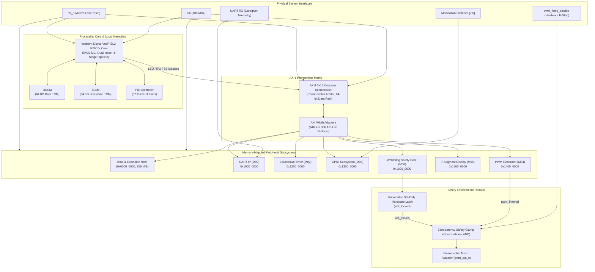

# 🏛️ NebuCore SoC — System Architecture Specification

---

## 📖 1. Executive Summary & Clinical Background

**NebuCore SoC** is a 32-bit RISC-V System-on-Chip architected specifically for **safety-critical, automated medical nebulizer dosage delivery**. 

In pulmonary drug delivery, aerosolized medication must be dispensed in strict volumetric quantities. Conventional commercial nebulizers rely heavily on software timers, leaving patients vulnerable to catastrophic overdosing if firmware locks up, enters an infinite loop, or experiences memory corruption.

NebuCore eliminates single-point software failures through **Hardware-Enforced Actuator Interlocking**:
* The processor accepts dosage volume inputs (mL) and programs treatment parameters.
* An autonomous hardware **Watchdog Timer (WDT)** runs in parallel with the core.
* Upon dosage completion or timeout, the hardware asserts an **irreversible, set-only interlock (`wdt_locked`)** that combinatorially clamps the piezoelectric PWM drive output (`pwm_out_o`) to **LOW** with **zero clock-cycle latency**.
* **Software cannot clear the hardware lock under any condition**; the actuator remains permanently disabled until a physical system reset (`rst_n`) occurs.

---

## 🗺️ 2. Top-Level Architectural Organization



---

## ⚙️ 3. Core Subsystems

### 3.1 RISC-V VeeR EL2 Processor Core
* **Architecture:** RISC-V standard RV32IMC (Base Integer + Hardware Multiply/Divide + Compressed Instructions).
* **Pipeline:** Superscalar dual-issue 4-stage in-order pipeline with branch prediction.
* **Master Interfaces:**
  1. **LSU (Load/Store Unit):** 64-bit AXI4 Master for data access.
  2. **IFU (Instruction Fetch Unit):** 64-bit AXI4 Master for boot and code streaming.
  3. **SB (System Bus):** 64-bit AXI4 Master for peripheral debug and DMA integration.
* **Internal Tightly-Coupled Memories:**
  * **ICCM (`0xEE00_0000`):** 64 KiB single-cycle latency instruction RAM.
  * **DCCM (`0xF004_0000`):** 64 KiB single-cycle latency data RAM.

### 3.2 AXI4 3-Master × 15-Slave Interconnect Matrix
* **Crossbar Fabric:** Full non-blocking crossbar interconnect with round-robin arbitration.
* **Address Decoding:** 32-bit memory-mapped decoding targeting 16 discrete memory and peripheral regions.
* **Width Conversion:** Integrated 64-bit to 32-bit protocol width adapters (`axi_width_adapter.sv`) bridging the 64-bit core LSU/IFU buses to 32-bit AXI4-Lite peripheral interfaces with byte-enable masking (`wstrb`).

### 3.3 Peripheral Subsystems
1. **System Boot & Work RAM (`0x0000_0000`):** 64-bit data bus hosting firmware machine code, stack, heap, and the UVM completion mailbox.
2. **UART Subsystem (`0x1000_0000`):** Full-duplex 16550-compatible serial interface for caregiver dosage programming and live telemetry streaming.
3. **Countdown Timer (`0x1200_0000`):** 32-bit down-counter generating microsecond-accurate ticks for dosage expiration tracking.
4. **GPIO Subsystem (`0x1300_0000`):** 8-bit bidirectional digital I/O connecting dosage volume selection DIP switches and status indicator LEDs.
5. **PWM Generator (`0x1400_0000`):** High-frequency pulse-width modulator generating 100 kHz driving waveforms for the ultrasonic aerosolization mesh.
6. **7-Segment Display Subsystem (`0x1500_0000`):** 4-digit auto-multiplexing cathode driver displaying real-time countdown seconds and error diagnostic codes.
7. **Watchdog Timer Core (`0x1600_0000`):** Autonomous safety monitor implementing dosage hardware interlock.

---

## 🔒 4. Zero-Latency Hardware Safety Interlock

The fundamental safety guarantee of NebuCore is mathematically expressed in the actuator output logic:

$$\text{pwm\_out\_o} = \text{pwm\_internal} \;\land\; (\neg\,\text{pwm\_force\_disable\_i}) \;\land\; (\neg\,\text{wdt\_locked})$$

```text
                  +-------------------------+
PWM Generator --->| pwm_internal            |
                  |                         |
Force E-Stop  --->| ~pwm_force_disable_i    |====> pwm_out_o (To Ultrasonic Mesh)
                  |                         |
Watchdog Latch--->| ~wdt_locked             |
                  +-------------------------+
                   (Combinational AND Gate)
```

### Safety Operational Invariants:
1. **Set-Only Hardware Latch:** Once `wdt_locked` is set to `1` by counter expiration, the latch cannot be reset by any AXI bus write, software instruction, or interrupt service routine.
2. **Immediate Override:** Deassertion of `pwm_out_o` occurs through pure combinational logic ($\le 1\text{ ns}$ gate delay), protecting patients against actuator over-activation even if the CPU clock is halted.
3. **Physical Reset Recovery:** The only mechanism to re-arm the actuator is an intentional physical hardware reset (`rst_n == 0`), requiring caregiver intervention.

---

## 📁 5. Supporting Documentation & Project References

* 🗺️ **[System Address & Register Map](ADDRESS_MAP.md):** Complete peripheral register offsets, bitfields, and base addresses.
* 🧪 **[Comprehensive Test Map](TEST_MAP.md):** UVM testbench structure, verification phases, and coverage plan.
* 📊 **[Full SoC Address Map Spreadsheet](Full_SoC_Address_Map.ods):** Multi-sheet OpenDocument spreadsheet.
* 🖼️ **[Architectural Diagrams Directory](diagrams/):** High-resolution block diagrams and timing captures.
