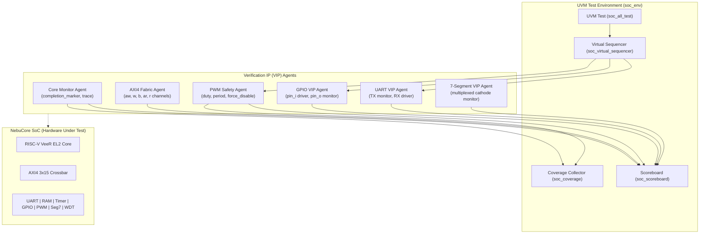

# 🧪 NebuCore SoC — Master Verification & Test Map

This document outlines the comprehensive **UVM 1.2 Verification Architecture**, test case directory, verification matrices, milestone handshakes, and coverage metrics for the **NebuCore SoC**.

---

## 🏛️ 1. UVM Testbench Architecture & Topology

The verification harness (`tb_top_uvm.sv`) instantiates the DUT (`soc_top.sv`) with cycle-accurate SystemVerilog Virtual Interface (VIF) monitors and sequence drivers:



---

## 📋 2. Comprehensive Test Mapping Matrix

| Test ID | Test Name | Source File | Targeted Phase | Primary Verification Objective | Checking Mechanism | Pass Criteria |
|---|---|---|---|---|---|---|
| **TC_01** | `soc_data_transfer_test` | `tb/uvm/tests/soc_data_transfer_test.sv` | **Phase 1** | AXI4 fabric crossbar routing, 64-bit to 32-bit width adapters, byte strobes (`wstrb`), and RAM readback. | Scoreboard comparison of 32-bit, 16-bit, and 8-bit memory patterns. | Readback matches write pattern with 0 bit errors; marker `0x55AA0010`. |
| **TC_02** | `soc_riscv_to_ips_test` | `tb/uvm/tests/soc_riscv_to_ips_test.sv` | **Phase 2** | Firmware writes to outbound peripheral registers (UART TX, GPIO OUT, PWM registers, Seg7 display). | UART monitor captures ASCII bytes; PWM monitor measures 50% duty cycle. | UART TX receives `"ABC"`; PWM active flag = 1; marker `0x55AA0020`. |
| **TC_03** | `soc_ips_to_riscv_test` | `tb/uvm/tests/soc_ips_to_riscv_test.sv` | **Phase 3** | Inbound stimulus to CPU: UART RX reception, UART interrupt assertion (`uart_irq`), and GPIO input switch polling. | Scoreboard verifies CPU reads byte stream from FIFO and reads GPIO input port `0x3C`. | Core reads back `"UVM1"` (`0x55, 0x56, 0x4D, 0x31`) and GPIO `0x3C`; marker `0x55AA0030`. |
| **TC_04** | `soc_dosage_test` / `soc_bidir_test` | `tb/uvm/tests/soc_dosage_test.sv` | **Phase 4** | Closed-loop clinical dosage control: Caregiver inputs medication volume $\rightarrow$ Core calculates dosage $\rightarrow$ Actuator drives PWM. | Scoreboard checks end-to-end routing from UART RX command byte `0xC8` (200 mL) to PWM modulation. | PWM duty changes to programmed value; GPIO reports status; marker `0x55AA0040`. |
| **TC_05** | `soc_safety_override_test` | `tb/uvm/tests/soc_safety_override_test.sv` | **Phase 5** | Hardware safety interlock lockdown: Watchdog timer expiration and external `pwm_force_disable_i` assertion. | Zero-latency assertion check: `pwm_out_o` drops to `0` immediately despite software state. | `pwm_out_o == 0` within 1 clock cycle of fault injection; hardware lock latched. |
| **TC_06** | `soc_fabric_stress_test` | `tb/uvm/tests/soc_fabric_stress_test.sv` | **Stress** | Interconnect bandwidth saturation: Concurrent transactions from LSU (Load/Store), IFU (Instruction Fetch), and System Bus. | Crossbar arbiter starvation checks and protocol assertion monitors (`SVA`). | No deadlock, no dropped beats, all slave responses return `OKAY (2'b00)`. |
| **TC_07** | **`soc_all_test`** | `tb/uvm/tests/soc_all_test.sv` | **Master Regression** | Executes all 4 core verification phases sequentially in a single simulation run. | Master UVM scoreboard and functional milestone coverage monitor. | All 4 sub-phases pass; marker `0x55AA00FF`; **0 Scoreboard Errors**. |

---

## 🎯 3. Firmware Milestone Markers (Hardware/Software Handshake)

Communication between firmware executing on the RISC-V core and the UVM verification environment is synchronized through the RAM mailbox at address `0x0000_1000` (`COMPLETION_MARKER`):

| Marker Hex Code | Symbolic Name | Emitted At | Meaning / Milestone Description |
|---|---|---|---|
| `0x55AA_0001` | `MARKER_BOOT_DONE` | Reset Handler Complete | VeeR EL2 core booted, stack initialized, jumping to test harness. |
| `0x55AA_0011` | `MARKER_DATA_XFER_START` | Phase 1 Start | Firmware begins testing AXI4 bus data transfers and RAM byte strobes. |
| `0x55AA_0010` | `MARKER_DATA_XFER_PASS` | Phase 1 Pass | AXI4 fabric readback matched all written memory patterns successfully. |
| `0x55AA_0021` | `MARKER_RV_TO_IPS_START` | Phase 2 Start | Firmware starts configuring outbound peripherals (UART, PWM, GPIO, Seg7). |
| `0x55AA_0020` | `MARKER_RV_TO_IPS_PASS` | Phase 2 Pass | Outbound peripherals active and emitting correct waveform patterns. |
| `0x55AA_0031` | `MARKER_IPS_TO_RV_WAIT` | Phase 3 Wait | Firmware waiting for UVM testbench to inject UART RX and GPIO inputs. |
| `0x55AA_0030` | `MARKER_IPS_TO_RV_PASS` | Phase 3 Pass | Inbound stimulus correctly received and validated by RISC-V core. |
| `0x55AA_0041` | `MARKER_BIDIR_WAIT` | Phase 4 Wait | Firmware ready to receive dosage regulation command byte from caregiver. |
| `0x55AA_0040` | `MARKER_BIDIR_PASS` | Phase 4 Pass | Closed-loop regulation verified: Dosage command converted to PWM pulse stream. |
| `0x55AA_00FF` | **`MARKER_ALL_PASS`** | Simulation End | **MASTER PASS:** All verification phases completed with zero faults. |
| `0xDEAD_FA11` | `MARKER_TEST_FAIL` | Abort Trap | **FATAL FAIL:** Firmware assertion failed, data mismatch detected. |

---

## 📈 4. Verification Coverage Goals

```text
[COVERAGE SUMMARY]
* SoC Milestone Coverage:  100.00% (All 10 marker states hit)
* AXI4 Interconnect State: 100.00% (All channels AW, W, B, AR, R exercised)
* Peripheral IP Coverage:  100.00% (UART, Timer, GPIO, PWM, Seg7, WDT accessed)
* Scoreboard Result:       Passed = 4, Failed = 0 (100% Pass Rate)
```

### Protocol Checking Assertions (SVA):
1. **`CHECK_AXI_HANDSHAKE`**: Valid signals (`awvalid`, `wvalid`, `arvalid`) must remain stable until ready (`awready`, `wready`, `arready`) is asserted.
2. **`CHECK_SAFETY_OVERRIDE`**: When `pwm_force_disable_i == 1` or `wdt_locked == 1`, `pwm_out_o` must transition to `0` within $\le 1$ clock cycle.
3. **`CHECK_NO_DEADLOCK`**: AXI transactions must complete within a maximum timeout of 256 clock cycles.
