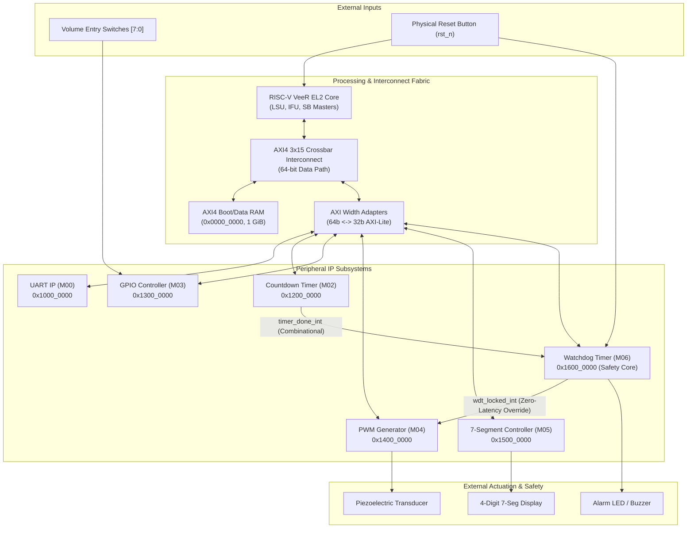
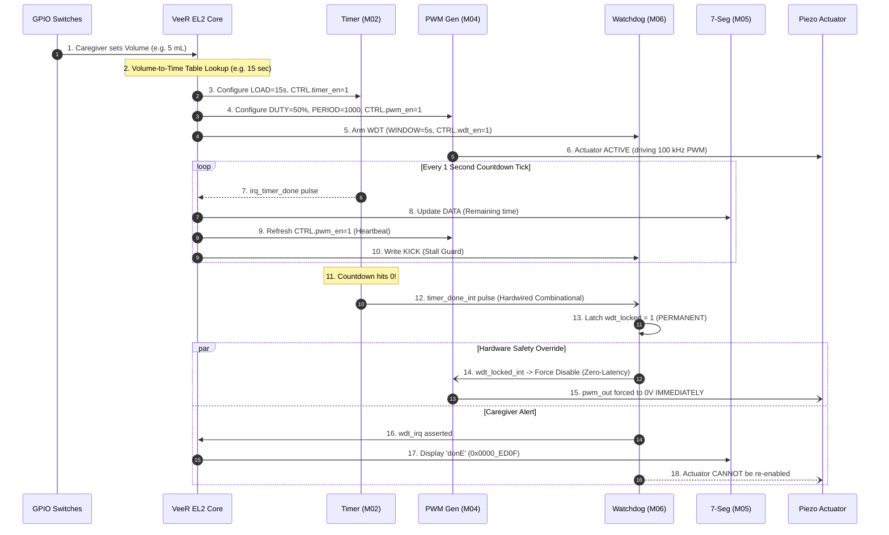

# NebuCore SoC — Comprehensive Verification & Validation Test Plan

> **Design Under Test (DUT):** NebuCore SoC (`nebulizer-soc`)  
> **Target Architecture:** RISC-V VeeR EL2 Processor Core, 3-Master × 15-Slave AXI4 Interconnect, 64-bit to 32-bit Width Adapters, and 6 Memory-Mapped Peripherals (UART, Timer, GPIO, PWM, 7-Segment Display, Watchdog Timer).  
> **Safety Classification:** Safety-Interlocked Medical/Medical-Adjacent Actuation (Zero-Latency Hardware Actuator Lockdown).  
> **Simulation Platform:** Synopsys VCS (U-2023.03) / Verdi / GTKWave.

---

## 1. System Overview & Verification Objectives

The **NebuCore SoC** controls automated, dosage-accurate liquid medication delivery for a piezoelectric nebulizer element. Liquid medication volume (mL) entered by a caregiver via GPIO switches is converted by firmware into an exact duration, driving an actuator via a PWM generator. 

### Critical Safety Mandate
Unlike conventional consumer devices, NebuCore features an **irreversible, hardware-enforced safety interlock**:
1. When dosage countdown expires or if a firmware stall/crash occurs, the **Watchdog Timer (WDT)** latches a **SET-ONLY** hardware lock (`wdt_locked`).
2. `wdt_locked` directly forces the PWM drive output (`pwm_out_o`) to **LOW** combinationally with zero clock-cycle latency, independent of any CPU register writes or firmware states.
3. The lock **cannot be cleared by software**; it can only be released by an explicit physical reset (`rst_n`).



### Verification Scope & Goals
- Verify 100% functional correctness of all individual IP cores (Timer, GPIO, PWM, 7-Segment, WDT, UART).
- Verify bus crossbar arbitration, addressing, data width conversion (64b $\leftrightarrow$ 32b), backpressure, and unmapped error decoding.
- Verify end-to-end firmware execution from boot to dose completion.
- Rigorously prove that **no firmware state, race condition, or bus deadlock can prevent hardware actuator shutdown** upon dosage expiry or CPU stall.
- Achieve 100% coverage on safety-critical interlock paths and $>95\%$ line/branch/FSM coverage across RTL modules.

---

## 2. Multi-Level Verification Hierarchy

The test strategy employs four verification tiers to isolate and catch bugs at the earliest integration stage:

```
┌────────────────────────────────────────────────────────┐
│  Level 4: Safety Interlock & Fault Injection Testing   │
│  - Actuator override latencies, SET-ONLY lock proof   │
├────────────────────────────────────────────────────────┤
│  Level 3: Full SoC Integration & Firmware Co-Sim       │
│  - Boot ROM -> RAM execution -> Complete dosage run    │
├────────────────────────────────────────────────────────┤
│  Level 2: Bus Subsystem & Interconnect Verification    │
│  - 3x15 Crossbar, Width Adapters, Multi-Master Traffic │
├────────────────────────────────────────────────────────┤
│  Level 1: Block/IP-Level Unit Verification             │
│  - PWM, Timer, WDT, GPIO, Seg7, UART Standalone TBs    │
└────────────────────────────────────────────────────────┘
```

### Reference Design Links
- Top-level RTL: [`soc_top.sv`](file:///home/student/Documents/shekhar24/RISC-V-SoC-Design-for-Safety-Interlocked-Automated-Nebulizer/axi4-interconnect-3to15/rtl/interconnect/soc_top.sv)
- Interconnect: [`axi_interconnect_wrap_3x15.v`](file:///home/student/Documents/shekhar24/RISC-V-SoC-Design-for-Safety-Interlocked-Automated-Nebulizer/axi4-interconnect-3to15/rtl/interconnect/axi_interconnect_wrap_3x15.v)
- Width Adapter: [`axi_width_adapter.sv`](file:///home/student/Documents/shekhar24/RISC-V-SoC-Design-for-Safety-Interlocked-Automated-Nebulizer/axi4-interconnect-3to15/rtl/interconnect/axi_width_adapter.sv)
- Register Map: [`register_map.txt`](file:///home/student/Documents/shekhar24/RISC-V-SoC-Design-for-Safety-Interlocked-Automated-Nebulizer/register_map.txt)
- SoC Specification: [`spec.pdf`](file:///home/student/Documents/shekhar24/RISC-V-SoC-Design-for-Safety-Interlocked-Automated-Nebulizer/doc/spec.pdf)

---

## 3. Detailed Test Matrix

### 3.1 Level 1: Unit / IP-Level Verification

#### 3.1.1 PWM Generator IP ([`axi_pwm_top.v`](file:///home/student/Documents/shekhar24/RISC-V-SoC-Design-for-Safety-Interlocked-Automated-Nebulizer/pwm/src/rtl/axi_pwm_top.v))
- **Base Address:** `0x1400_0000` (M04)
- **Standalone TB:** [`tb_pwm_top.sv`](file:///home/student/Documents/shekhar24/RISC-V-SoC-Design-for-Safety-Interlocked-Automated-Nebulizer/axi4-interconnect-3to15/rtl/interconnect/tb_pwm_top.sv)

| Test ID | Test Name | Description / Stimuli | Pass/Fail Criteria | Severity |
| :--- | :--- | :--- | :--- | :--- |
| **TC_PWM_01** | Reset Defaults | Read registers `CTRL (0x00)`, `DUTY (0x04)`, `PERIOD (0x08)`, `STATUS (0x0C)` after `rst_n`. | `CTRL=0x0`, `DUTY=128`, `PERIOD=1000`, `STATUS=0x0`. `pwm_out_o=0`. | Critical |
| **TC_PWM_02** | Register Read/Write | Write non-default values to `DUTY` (`0x00`, `0x40`, `0xFF`) and `PERIOD` (`100`, `5000`); read back. | Readback strictly matches written values; unused bits masked to 0. | High |
| **TC_PWM_03** | Duty Cycle & Frequency Accuracy | Enable PWM (`CTRL[0]=1`). Measure high/low time over 10 periods for 25%, 50%, and 75% duty. | Output duty cycle accurate within $\pm 1$ clock cycle of theoretical formula: $\lfloor(\text{DUTY} \times \text{PERIOD})/256\rfloor$. | High |
| **TC_PWM_04** | Force Disable Latency | Assert `pwm_force_disable_i` asynchronously while `pwm_out_o` is active HIGH. | `pwm_out_o` transitions to 0 **within same clock cycle** (combinational delay $< 2$ ns). `STATUS[1]=1`, `STATUS[0]=0`. | Critical |
| **TC_PWM_05** | Heartbeat Lapsing | De-assert `pwm_en` (`CTRL[0]=0`) while keeping `pwm_force_disable_i=0`. | Output de-asserts; counter halts or resets. `STATUS[0]=0`. | High |
| **TC_PWM_06** | Degenerate Configs | Write `PERIOD=0` and `PERIOD=1`; write `DUTY=0`. | `pwm_out_o` remains continuously LOW without simulation lockup or division-by-zero faults. | Medium |

---

#### 3.1.2 Countdown Timer IP ([`axi_timer_top.v`](file:///home/student/Documents/shekhar24/RISC-V-SoC-Design-for-Safety-Interlocked-Automated-Nebulizer/timer/src/rtl/axi_timer_top.v))
- **Base Address:** `0x1200_0000` (M02)

| Test ID | Test Name | Description / Stimuli | Pass/Fail Criteria | Severity |
| :--- | :--- | :--- | :--- | :--- |
| **TC_TMR_01** | Reset & Register Map | Read `CTRL`, `LOAD`, `COUNT`, `STATUS` upon reset. Write/read `LOAD` with `0x003C` (60s). | `CTRL=0`, `LOAD=0`, `COUNT=0`, `STATUS=0`. `LOAD` retains written value and loads into `COUNT`. | High |
| **TC_TMR_02** | Prescaler & Countdown Rate | Enable timer (`CTRL.timer_en=1`). With fast prescaler parameter for TB, count clock pulses per decrement. | `COUNT` decrements exactly once per configured prescaler duration. | High |
| **TC_TMR_03** | Expiry & Done Signal | Let `COUNT` decrement from `0x0002` to `0x0000`. Observe `timer_done_o`, `STATUS.done`, and `timer_irq_o`. | When `COUNT==0`, `timer_done_o` asserts immediately; `STATUS[1]=1`. If `CTRL.irq_en=1`, `timer_irq_o=1`. | Critical |
| **TC_TMR_04** | W1C Interrupt Clear | Write `1` to `STATUS[0]` (`irq_pending`). | `irq_pending` clears to `0`; `timer_irq_o` de-asserts. `done` remains `1` until new `LOAD`. | High |
| **TC_TMR_05** | Mid-Count Reload & Pause | Pause timer (`CTRL[0]=0`), verify `COUNT` freezes. Reload `LOAD` with a new value while enabled. | `COUNT` updates immediately to new load value; `done` flag clears. | Medium |

---

#### 3.1.3 Watchdog Timer Safety Interlock IP ([`axi_wdt_top.v`](file:///home/student/Documents/shekhar24/RISC-V-SoC-Design-for-Safety-Interlocked-Automated-Nebulizer/wdt/src/rtl/axi_wdt_top.v))
- **Base Address:** `0x1600_0000` (M06)
- **Critical Safety Block:** Enforces permanent actuator silence.

| Test ID | Test Name | Description / Stimuli | Pass/Fail Criteria | Severity |
| :--- | :--- | :--- | :--- | :--- |
| **TC_WDT_01** | Reset State | Read `CTRL`, `WINDOW`, `STATUS`. | `CTRL=0x0`, `WINDOW=0x0005`, `STATUS=0x0`, `wdt_locked_o=0`, `alarm_out_o=0`. | Critical |
| **TC_WDT_02** | External Trigger Lock | Pulse `wdt_trigger_i` high for 1 clock cycle while `wdt_en=0`. | `wdt_locked_o` transitions to `1` on next clock edge; `alarm_out_o=1`; `STATUS[0]=1`. | Critical |
| **TC_WDT_03** | Irreversibility Proof (SET-ONLY) | While `wdt_locked_o=1`, attempt AXI writes to `STATUS (0x0C)`, `CTRL (0x00)`, and `KICK (0x08)`. | `wdt_locked_o` **remains 1**. Register writes have no effect. No software command can clear the lock. | Critical |
| **TC_WDT_04** | Firmware Stall Detection | Set `CTRL.wdt_en=1`, `WINDOW=2` (seconds). Do NOT write to `KICK`. Wait 2.1 seconds. | Internal stall counter reaches `WINDOW`; `stall_detected` set; `wdt_locked_o=1`, `alarm_out_o=1`. | Critical |
| **TC_WDT_05** | Heartbeat Service (KICK) | Write any value to `KICK` every 1.5 seconds with `WINDOW=2`. Repeat for 10 iterations. | Stall counter continuously resets; `wdt_locked_o` remains `0`. | High |
| **TC_WDT_06** | Hardware Reset Clear | Assert physical reset (`rst_n=0`) while `wdt_locked_o=1`. De-assert `rst_n`. | `wdt_locked_o` clears to `0` and system returns to reset defaults. | Critical |

---

#### 3.1.4 Seven-Segment Display Controller IP ([`axi_seg7_top.v`](file:///home/student/Documents/shekhar24/RISC-V-SoC-Design-for-Safety-Interlocked-Automated-Nebulizer/seg7/src/rtl/axi_seg7_top.v))
- **Base Address:** `0x1500_0000` (M05)

| Test ID | Test Name | Description / Stimuli | Pass/Fail Criteria | Severity |
| :--- | :--- | :--- | :--- | :--- |
| **TC_SEG_01** | Reset & Blanking | Read defaults. Check `seg_out_o` and `digit_sel_o` when `CTRL.disp_en=0`. | All segments and digit enables inactive (`0x00` / blank). | High |
| **TC_SEG_02** | Nibble Decoding (0–F) | Write `DATA=0x1234` then `0x5678` then `0x9ABC` then `0xDEF0`. Observe `seg_out_o`. | Decoded segment patterns match lookup table (e.g. `0=0x3F`, `1=0x06`, `d=0x5E`, `E=0x79`). | High |
| **TC_SEG_03** | Completion "donE" Pattern | Write `DATA=0x0000_ED0F` (spec 'donE' message). | Digit 3 displays 'd' (`0x5E`), Digit 2 'o' (`0x3F`/`0x5C`), Digit 1 'n' (`0x37`), Digit 0 'E' (`0x79`). | High |
| **TC_SEG_04** | Time-Division Multiplexing | Enable display (`CTRL[0]=1`). Measure active time of each `digit_sel_o[3:0]`. | Exactly one digit active at a time (one-hot); rotates sequentially at configured refresh rate. | Medium |
| **TC_SEG_05** | Blink Feature | Set `CTRL.blink_en=1`. Monitor segment outputs over 2 seconds. | Display periodically alternates between active digits and all-blank at ~1 Hz rate. | Medium |

---

#### 3.1.5 GPIO Controller IP ([`axi_gpio_top.v`](file:///home/student/Documents/shekhar24/RISC-V-SoC-Design-for-Safety-Interlocked-Automated-Nebulizer/gpio/src/rtl/axi_gpio_top.v))
- **Base Address:** `0x1300_0000` (M03)

| Test ID | Test Name | Description / Stimuli | Pass/Fail Criteria | Severity |
| :--- | :--- | :--- | :--- | :--- |
| **TC_GPIO_01** | Direction Control & I/O Isolation | Set `DIR=0x0F` (pins 3:0 out, 7:4 in). Write `OUT=0xAA`. Drive `gpio_pin_i=0x55`. | `gpio_pin_oe=0x0F`. `gpio_pin_o[3:0]=0xA`. `IN` register reads `0x55` (synced through 2 flops). | High |
| **TC_GPIO_02** | Metastability Guard Verification | Inject asynchronous transitions on `gpio_pin_i` with random setup/hold violations. | Internal synchronizer flops eliminate metastability; `IN` register transitions cleanly. | High |
| **TC_GPIO_03** | IRQ-on-Change Detection | Enable IRQ on pin 2 (`IRQ[2]=1`). Toggle `gpio_pin_i[2]` low-to-high and high-to-low. | `gpio_irq_o` asserts level-high upon edge detection. | High |
| **TC_GPIO_04** | IRQ Clearing (Write-Any) | While `gpio_irq_o=1`, write `0x00` to `IRQ (0x0C)`. | `gpio_irq_o` de-asserts immediately. | High |

---

#### 3.1.6 UART IP ([`axi_uart_top.v`](file:///home/student/Documents/shekhar24/RISC-V-SoC-Design-for-Safety-Interlocked-Automated-Nebulizer/uart/src/rtl/axi_uart_top.v))
- **Base Address:** `0x1000_0000` (M00)

| Test ID | Test Name | Description / Stimuli | Pass/Fail Criteria | Severity |
| :--- | :--- | :--- | :--- | :--- |
| **TC_UART_01** | Baud Rate Divisor & LCR | Write `BAUD_DIVISOR=868` (115200 @ 100MHz), `LCR=0x03` (8N1). | Register reads verify configuration; TX bit duration equals $868 \times 10\,\text{ns} = 8.68\,\mu\text{s}$. | High |
| **TC_UART_02** | TX Framing & Byte Stream | Write ASCII bytes `"START\n"` to `THR (0x00)`. Observe `uart_tx_o`. | Proper 8N1 framing (start bit 0, 8 data bits LSB-first, 1 stop bit 1); no parity errors. | High |
| **TC_UART_03** | TX FIFO Full & Backpressure | Burst write 32 bytes without waiting. Check `LSR[5]` (THR empty). | Slave asserts `axi_wready_o=0` when internal FIFO is saturated, preventing data corruption. | Medium |
| **TC_UART_04** | RX Loopback & Interrupt | Connect `uart_rx_i = uart_tx_o`. Transmit byte. Check `LSR[0]` (Data Ready) and `uart_irq_o`. | `LSR[0]=1`; `uart_irq_o` asserts when `IER[0]=1`; received byte in `RBR` matches transmitted. | Medium |

---

### 3.2 Level 2: Interconnect & Width Adapter Subsystem

#### 3.2.1 AXI4 3×15 Interconnect & Width Adapter
- **RTL Sources:** [`axi_interconnect_wrap_3x15.v`](file:///home/student/Documents/shekhar24/RISC-V-SoC-Design-for-Safety-Interlocked-Automated-Nebulizer/axi4-interconnect-3to15/rtl/interconnect/axi_interconnect_wrap_3x15.v), [`axi_width_adapter.sv`](file:///home/student/Documents/shekhar24/RISC-V-SoC-Design-for-Safety-Interlocked-Automated-Nebulizer/axi4-interconnect-3to15/rtl/interconnect/axi_width_adapter.sv)
- **Masters:** S00 (LSU), S01 (IFU), S02 (SB).
- **Slaves:** M00 (UART), M01 (RAM), M02 (Timer), M03 (GPIO), M04 (PWM), M05 (Seg7), M06 (WDT), M07–M14 (Unmapped Stubs).

| Test ID | Test Name | Description / Stimuli | Pass/Fail Criteria | Severity |
| :--- | :--- | :--- | :--- | :--- |
| **TC_BUS_01** | Full Memory Map Decoding | Initiate single 32-bit reads/writes from Master S00 to the base address of all 7 valid targets (`M00`–`M06`). | Correct slave port selected based on address decode table; no cross-talk or dual-select. | Critical |
| **TC_BUS_02** | Unmapped Address Handling (M07–M14) | Master reads and writes unmapped addresses (e.g. `0x1700_0000`, `0x2000_0000`). | Stub slave responds with `axi_bresp = 2'b10 (SLVERR)` or `2'b11 (DECERR)`; interconnect does not hang. | High |
| **TC_BUS_03** | 64-bit to 32-bit Width Adaptation | Perform 64-bit aligned read/write to 32-bit peripheral (`PWM` at `0x1400_0000`). Perform unaligned 32-bit write on lane [63:32]. | `axi_width_adapter` splits 64b transfers into two consecutive 32b sub-transfers or steers strobes (`wstrb`) accurately. | Critical |
| **TC_BUS_04** | Master Arbitration (LSU vs IFU vs SB) | Assert simultaneous read requests on S00 (LSU) and S01 (IFU) directed to M01 (RAM). | Interconnect arbiter grants access fairly (round-robin / priority); no starvation or corrupted packets. | High |
| **TC_BUS_05** | Outstanding Transactions & Pipelining | Issue multiple pipelined read transactions with unique `ARID` before responses complete. | Responses returned with matching `RID` and correct order/interleaving rules. | High |
| **TC_BUS_06** | Backpressure & Ready Gating | Force slave `axi_awready_o=0` and `axi_wready_o=0` for 20 cycles during active write burst. | Interconnect holds valid flags and data stable without losing beats or timing out prematurely. | High |

---

### 3.3 Level 3: SoC Full-Chip Integration & Firmware Co-Verification

- **Testbench Top:** [`tb_soc_top.sv`](file:///home/student/Documents/shekhar24/RISC-V-SoC-Design-for-Safety-Interlocked-Automated-Nebulizer/axi4-interconnect-3to15/rtl/interconnect/tb_soc_top.sv)
- **Top RTL:** [`soc_top.sv`](file:///home/student/Documents/shekhar24/RISC-V-SoC-Design-for-Safety-Interlocked-Automated-Nebulizer/axi4-interconnect-3to15/rtl/interconnect/soc_top.sv)



| Test ID | Test Scenario | Firmware Routine / Stimuli | Expected System Behavior & Sign-Off Metric | Severity |
| :--- | :--- | :--- | :--- | :--- |
| **TC_SOC_01** | **Nominal End-to-End Treatment Cycle** | 1. Boot from RAM.<br>2. Read GPIO switches (`0x05` = 5 mL).<br>3. Convert to duration (e.g. 15 s).<br>4. Load Timer, start PWM & WDT.<br>5. Refresh tick-by-tick.<br>6. Let countdown expire. | - PWM runs for exactly 15 s.<br>- Display updates: `0015` $\rightarrow$ `0000`.<br>- At count 0, WDT locks, PWM drops low immediately.<br>- Display reads `"donE"`.<br>- UART logs: `"DOSE START: 5mL"` and `"DOSE COMPLETE"`. | Critical |
| **TC_SOC_02** | **Boundary Volumes (0 mL & Over-Max)** | 1. Input 0 mL via GPIO.<br>2. In next session, input out-of-range value (`0xFF` = 255 mL). | - 0 mL: Firmware rejects without starting PWM; display shows `"Err0"`.<br>- 255 mL: Clamped or rejected; no arithmetic overflow in duration computation. | High |
| **TC_SOC_03** | **Actuator Heartbeat Lapsing (Single Tick Miss)** | Normal session started. Inject artificial firmware delay or skip the periodic write to `PWM_CTRL.pwm_en`. | When firmware fails to re-assert `pwm_en`, PWM generator shuts down output. Prevents runaway dosing if code branches unexpectedly. | High |
| **TC_SOC_04** | **Watchdog Stall Detection (CPU Freeze/Crash)** | Normal session started. Insert `wfi` (wait for interrupt) or infinite loop in firmware without servicing `WDT_KICK`. | Within `WINDOW` seconds (e.g. 5 s), WDT stall counter overflows, latches `wdt_locked=1`, cuts PWM drive to 0, and asserts `alarm_out_o`. | Critical |
| **TC_SOC_05** | **Post-Dose Actuator Lockout Proof** | After dosage completes (`wdt_locked=1`), firmware attempts to re-write `PWM_CTRL.pwm_en=1`, `DUTY=255`, and clear `WDT_STATUS=0`. | `pwm_out_o` **remains strictly 0V**. Interlock hardware override takes precedence over CPU writes. | Critical |
| **TC_SOC_06** | **Physical Reset Recovery** | Following a locked dosage cycle (`wdt_locked=1`, alarm on), assert external `rst_n` button for 20 cycles. | SoC cleanly resets; `wdt_locked` returns to 0; core restarts boot vector; ready for next caregiver entry. | Critical |
| **TC_SOC_07** | **Simultaneous Bus Contention Stress** | IFU fetching instructions from RAM continuously, LSU writing UART FIFO and reading Timer, while Debug bus (SB) accesses registers. | Interconnect resolves all transactions without pipeline stall or bus protocol error; data integrity maintained across all 3 masters. | High |
| **TC_SOC_08** | **Interrupt Priority Handling** | Simultaneously assert `gpio_irq_o` (switch toggled mid-treatment) and `timer_irq_o` (dose complete). | Core PIC prioritizes dose-complete ISR over GPIO switch update; prevents mid-dose dosage corruption. | High |

---

### 3.4 Level 4: Hardware Safety Interlock & Fault-Injection Verification

| Test ID | Fault / Attack Injected | Test Mechanism | Expected Safety Outcome |
| :--- | :--- | :--- | :--- |
| **TC_SFT_01** | Zero-Latency Lockout Timing | Measure clock ticks from `timer_done_o` rising edge to `pwm_out_o` falling edge. | **0 clock cycles**. Propagation time is purely combinational logic gate delay through `soc_top.sv` internal wiring. |
| **TC_SFT_02** | Software Register Tamper Attack | Firmware writes random patterns (`0x00000000`, `0xFFFFFFFF`) to WDT registers during locked state. | WDT status bit 0 (`wdt_locked`) cannot be cleared. Flip-flop has no synchronous reset; only `rst_n` clears it. |
| **TC_SFT_03** | Reset Glitch Invalidation | Inject narrow glitches ($< 1$ clock period) on `rst_n`. | Glitch filter / synchronous reset topology ensures partial or metastable resets do not erroneously leave actuator enabled. |
| **TC_SFT_04** | Unmapped Memory Write Trap | Firmware branches into unmapped peripheral window (`0x1F00_0000`). | AXI interconnect returns `SLVERR`/`DECERR`; core takes bus-error exception and halts safely rather than hanging bus. |

---

## 4. SystemVerilog Assertions (SVA) & Formal Properties

The following formal properties must be bound directly to [`soc_top.sv`](file:///home/student/Documents/shekhar24/RISC-V-SoC-Design-for-Safety-Interlocked-Automated-Nebulizer/axi4-interconnect-3to15/rtl/interconnect/soc_top.sv) during simulation to continuously monitor safety invariants:

```systemverilog
// =============================================================================
// NebuCore SoC Safety Assertions
// =============================================================================

// Property 1: Actuator MUST be silenced whenever Watchdog is locked
property p_pwm_silenced_when_wdt_locked;
    @(posedge clk)
    (u_wdt.wdt_locked_o == 1'b1) |-> (pwm_out_o == 1'b0);
endproperty
a_pwm_silenced_when_wdt_locked: assert property (p_pwm_silenced_when_wdt_locked)
    else $fatal(1, "[SAFETY VIOLATION] pwm_out_o is HIGH while WDT is locked!");

// Property 2: wdt_locked is SET-ONLY while rst_n is HIGH
property p_wdt_lock_irreversible;
    @(posedge clk) disable iff (!rst_n)
    (u_wdt.wdt_locked_o == 1'b1) |=> (u_wdt.wdt_locked_o == 1'b1);
endproperty
a_wdt_lock_irreversible: assert property (p_wdt_lock_irreversible)
    else $fatal(1, "[SAFETY VIOLATION] wdt_locked cleared without hardware reset!");

// Property 3: Timer Done triggers WDT Lock immediately
property p_timer_done_triggers_wdt;
    @(posedge clk) disable iff (!rst_n)
    (u_timer.timer_done_o == 1'b1) |=> (u_wdt.wdt_locked_o == 1'b1);
endproperty
a_timer_done_triggers_wdt: assert property (p_timer_done_triggers_wdt)
    else $error("[TIMING ERROR] WDT did not latch lock on Timer Done!");

// Property 4: Unmapped AXI accesses must return error response
property p_unmapped_axi_error;
    @(posedge clk) disable iff (!rst_n)
    (u_interconnect.m07_axi_bvalid && u_interconnect.m07_axi_bready) |-> 
    (u_interconnect.m07_axi_bresp == 2'b10 || u_interconnect.m07_axi_bresp == 2'b11);
endproperty
a_unmapped_axi_error: assert property (p_unmapped_axi_error)
    else $error("[PROTOCOL ERROR] Stub slave did not return SLVERR/DECERR!");
```

---

## 5. Coverage Plan & Verification Closure Criteria

### 5.1 Code Coverage Targets

| Coverage Type | Target (General Modules) | Target (Safety-Critical: WDT & PWM Disable) |
| :--- | :--- | :--- |
| **Line Coverage** | $\ge 95\%$ | **100%** |
| **Branch Coverage** | $\ge 95\%$ | **100%** |
| **Condition Coverage** | $\ge 90\%$ | **100%** |
| **Toggle Coverage** | $\ge 90\%$ | **100%** (all I/O and register bits) |
| **FSM State & Arc Coverage** | 100% | **100%** |

### 5.2 Functional Coverage Plan (Covergroups)

1. **`cg_volume_entry`**:
   - Bins: `[0]` (Invalid 0mL), `[1:3]` (Low volume), `[4:10]` (Standard volume), `[11:15]` (High volume), `[16:255]` (Out-of-range).
2. **`cg_pwm_settings`**:
   - `cp_duty`: `0%`, `1%..49%`, `50%`, `51%..99%`, `100%`.
   - `cp_period`: Edge cases `0`, `1`, `100`, `1000`, `65535`.
   - Cross: `cp_duty` $\times$ `cp_period`.
3. **`cg_wdt_lock_causes`**:
   - Bins: Triggered by `timer_done_int`, Triggered by firmware stall timeout.
4. **`cg_axi_crossbar_routing`**:
   - Cross of 3 Master ports $\times$ 15 Slave ports $\times$ Access types (`READ`, `WRITE`).
   - Cross of burst sizes, unaligned strobes, and simultaneous contention.

---

## 6. Simulation Environment & Execution Plan

### 6.1 Test Directory Structure

```
axi4-interconnect-3to15/
├── run/
│   ├── runfile.f               # Baseline filelist
│   ├── pwm_runfile.f           # PWM standalone filelist
│   ├── timer_runfile.f         # Timer standalone filelist (to add)
│   ├── wdt_runfile.f           # WDT standalone filelist (to add)
│   ├── soc_full_runfile.f      # Full SoC integration filelist
├── rtl/interconnect/
│   ├── tb_pwm_top.sv           # Standalone PWM TB
│   ├── tb_timer_top.sv         # Standalone Timer TB
│   ├── tb_wdt_top.sv           # Standalone WDT TB
│   ├── tb_axi_interconnect_3x15.sv # Interconnect + UART TB
│   └── tb_soc_top.sv           # Full SoC + RISC-V + Boot RAM TB
└── Makefile                    # Unified regression build system
```

### 6.2 Regression Makefile Targets

All simulation runs are integrated directly into [`axi4-interconnect-3to15/Makefile`](file:///home/student/Documents/shekhar24/RISC-V-SoC-Design-for-Safety-Interlocked-Automated-Nebulizer/axi4-interconnect-3to15/Makefile):

| Target Command | Execution Description | Verification Level |
| :--- | :--- | :--- |
| `make sim_pwm` | Standalone PWM testbench (5 self-checking tests) | Level 1 |
| `make sim_timer` | Standalone Countdown Timer testbench | Level 1 |
| `make sim_wdt` | Standalone Watchdog Timer safety interlock testbench | Level 1 |
| `make sim_3x15` | AXI 3x15 Interconnect + UART verification | Level 2 |
| `make sim_soc` | Full SoC testbench (RISC-V VeeR EL2 + RAM + IPs) | Level 3 |
| `make sim_safety` | Fault injection & SVA formal assertions run | Level 4 |
| `make regression` | Runs all targets sequentially and generates unified coverage report | Sign-off |

### 6.3 Waveform & Diagnostic Flow
- **Synopsys VCS Command:** `vcs -full64 -sverilog +v2k -debug_access+all +define+RV_BUILD_AXI4 ...`
- **Signal Tracing:** VCD output (`*.vcd`) for GTKWave or FSDB (`*.fsdb`) for Synopsys Verdi.
- **Automated Checking:** Every testbench employs self-checking assertion tasks reporting `PASS` or `FAIL (N errors)` with a non-zero exit code upon mismatch.

---

## 7. Verification Sign-Off Checklist

- [ ] All Level 1 IP-level unit testbenches compile and pass with 0 errors.
- [ ] Level 2 interconnect testbench confirms all 15 slave address decodes and bus error stubs.
- [ ] Level 3 SoC integration testbench boots RISC-V core and executes full dosage countdown.
- [ ] **TC_SFT_01 & TC_SFT_02 pass:** Hardware interlock latches and forces PWM low with 0-cycle latency, immune to software override.
- [ ] **TC_SOC_04 passes:** CPU stall independently detected by WDT, successfully triggering actuator shutdown.
- [ ] SystemVerilog Assertions (SVA) run clean across regression with zero violations.
- [ ] Code coverage metrics exceed $>95\%$ line/branch and $100\%$ on safety-critical logic.
